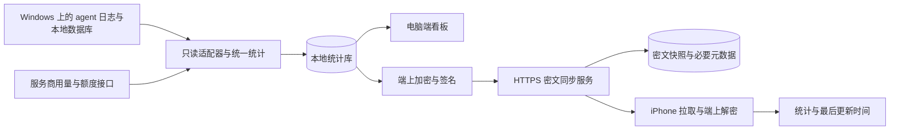

# Windows 与 iPhone Agent 用量记录：调研与选型

调研日期：2026-10-02（Asia/Shanghai）。本轮查阅官网、GitHub 仓库/发布、部分关键源码与官方技术文档；只生成研究文档。没有安装、运行候选软件、修改 agent 配置、创建云资源或上传个人使用数据。

## 选型结论

优先评估 **Javis603/token-monitor 的 Windows 端 + Tokscale 采集能力**，保留其已有桌面技术栈，补独立 iOS App 和端到端加密同步。它是本次找到的最接近目标的整体基础，但不是可以直接满足全部确认需求的成品。

它已有 Windows 发布包、多设备同步和 iOS 小组件接入，差距是：iPhone 依赖 Widgy / Scriptable，尚不是独立 App；现有 Hub 可读取统计、在云端聚合，而且同一共享密钥用于多个权限。v0.65.0 的 Worker 源码会把设备记录写入 storage，并在服务器调用 aggregateDevices，足以判断现有协议不满足用户要求的统计内容端到端加密。[项目](https://github.com/Javis603/token-monitor)、[v0.65.0 API](https://github.com/Javis603/token-monitor/blob/v0.65.0/docs/API.md)、[Worker 源码](https://github.com/Javis603/token-monitor/blob/v0.65.0/worker/src/index.js)。

若其字段、数据粒度、性能或维护耦合不适合定制，可选择新建 Windows 壳和 iOS App，但继续复用经过验证的采集解析器。先验证采集与加密闭环，再决定是否重写界面；现在没有足够的运行证据决定整个项目 fork 优于提取采集组件。

## Nowdex 的实际参考价值

当前中文官网展示 Mac 菜单栏、iPhone / iPad、额度与重置窗口、token/费用历史、热力图及今日小组件，并注明 token 用量由 tokens.ci 支持。官网同时描述设备直接读取 provider 用量，账号配置通过 iCloud 同步、凭据使用 Keychain。这是两类数据通道，不能据此推断本机历史统计完全不经外部服务。[中文官网](https://nowdex.app/zh-hans/)。

搜索引擎较早缓存未包含 token 历史；本轮已用直接 HTTP 读取核对中文页。未找到 Nowdex 官方公开源码仓库，因此以其为功能和信息结构参考，不把它作为可直接复用的开源底座，也不宣称已审计其内部实现。

## GitHub 候选

Stars、版本为本轮查询快照；它们表示社区关注和发布活动，不等价于稳定性或安全证明。许可证来自仓库元数据及必要的 LICENSE 文件核对；不是完整依赖许可证审计。

| 候选 | 当前快照 | 适合复用的部分 | 与本需求的差距 | 建议 |
|---|---|---|---|---|
| [token-monitor](https://github.com/Javis603/token-monitor) | MIT，2,554 stars，v0.65.0；Windows 发布包 | Electron 桌面、Tokscale、额度、历史、多设备 Hub | iOS 为小组件脚本；同步需要端到端加密和权限拆分 | **首要整体候选** |
| [Tokscale](https://github.com/junhoyeo/tokscale) | MIT，5,602 stars，v4.17.0 | Rust 解析/聚合、丰富 agent 适配、结构化导出 | CLI / TUI 与网页可视化；不能直接交付专用 iPhone App；各来源能力不相同 | **首要采集候选** |
| [TokenTracker](https://github.com/xiufengsun/TokenTracker) | MIT，1,943 stars，v1.1.8；Windows 发布包 | 桌面看板、采集、额度与项目统计；另一套 Trae 适配 | 首次运行会写 hooks / notify / 插件；默认匿名遥测；现有云同步不证明满足 E2EE | 对照候选与专项采集参考 |
| [ccusage](https://github.com/ccusage/ccusage) | MIT，18,838 stars，v20.0.26 | 本地日/周/月/会话统计、JSON、模型/缓存处理 | CLI，没有本产品所需的手机配对、云同步与独立 iOS 界面 | 独立对照核算与较小接入方案 |
| [Win-CodexBar](https://github.com/nesszer/Win-CodexBar) | MIT，1,132 stars，v0.60.3 | Tauri + React + Rust、provider 额度读取、Windows 凭据保护 | 不是现成独立 iPhone 历史统计产品；部分适配用 Cookie / 内部接口 | 额度适配与 Windows 托盘参考 |
| [tokens / tokens.ci](https://github.com/missuo/tokens) | MIT，198 stars，v27.1.1 | Tokscale 派生采集、网页、提交/去重；与 Nowdex 统计功能关系最直接 | 主产品是公共使用排行榜；用户要求私人统计和 E2EE | 参考源码，首版不接公共站点 |
| [Happy](https://github.com/slopus/happy) | MIT，23,980 stars，CLI 发布 cli-1.2.3 | iOS / Android 客户端、配对、远程同步与加密设计 | 主要解决运行/交互 agent；统计覆盖目标不同，采用包装器改变入口 | 参考配对与加密，避免整套引入首版 |
| [HAPI](https://github.com/tiann/hapi) | AGPL-3.0，5,160 stars，v0.30.7；Windows 发布包 | 本地 Hub、手机访问、SQLite、远程连接结构 | 主要是 agent 控制平台；加密边界不同；许可证需独立核查 | 架构参考，不作为默认产品底座 |

token-monitor v0.65.0 的 package.json 与 lockfile 都指向 Tokscale 4.17.0；没有将 Tokscale 当前 main 的所有功能自动算作已打包交付。版本可能有新格式差异，实施时需固定版本，并验证升级后的实际解析能力。[v0.65.0 package.json](https://github.com/Javis603/token-monitor/blob/v0.65.0/package.json)、[lockfile](https://github.com/Javis603/token-monitor/blob/v0.65.0/package-lock.json)。

TokenTracker 的隐私文件说明默认 heartbeat / 页面分析及关闭开关；这不等于上传会话内容。它的默认 hooks 修改与网络活动都需要纳入后续接入评估，不能因为名称含 local-first 就假定完全不改配置或不联网。[隐私说明](https://github.com/xiufengsun/TokenTracker/blob/main/docs/PRIVACY.md)。

其他专项方案：

| 方案 | 参考价值 | 不作为首版底座的原因 |
|---|---|---|
| [WorkBuddy-Switch](https://github.com/koi128bit/WorkBuddy-Switch) | WorkBuddy / Trae CN / TRAE Work 的字段、积分口径和账号映射 | macOS 原生账号管理产品，包含本需求没有授权的账号切换/会话迁移 |
| [LiteLLM](https://github.com/BerriAI/litellm) | 价格数据、BYOK API 计量与网关成本管理 | 只能测量它实际处理的 API 请求，不能被动获得所有既有订阅工具用量；改路由不是本轮目标 |
| [Langfuse](https://github.com/langfuse/langfuse) | 事件、trace、LLM 应用观测与分析思路 | 需要 instrument / ingest；不是自动读取本机全部 agent 的通用采集器，完整部署超出个人统计首版需要 |

## 重点 agent 的支持证据与限制

下面是官方能力或开源适配证据，**不是本机运行验收结果**。

| 来源 | 可参考的读取路径/机制 | 重要边界 |
|---|---|---|
| Codex Desktop / CLI | 本地 session / archive 的 token 事件；官方 app-server 的 account/rateLimits/read；当前文档另有 account/usage/read | 两个入口可能共用日志根目录；依据 originator 等证据区分。账号级统计与本机明细分开；当前安装版本是否支持新 RPC 未验证 |
| Claude Code | 本地 projects JSONL；官方 OpenTelemetry token / cost / request 等指标 | OTel 适合未来实时采集，不自动补历史；启用时只选指标，避免导出提示词/响应事件 |
| OpenCode | SQLite 与旧版 JSON；本机 server API / 事件 | 版本升级导致储存格式变化；本地 server 具备其他操作能力，不能直接作为手机只读公开 API |
| WorkBuddy | JSONL 的 providerData usage、SQLite fallback、独立 credits / quota | 有字段的 token、汇总 fallback、积分要分开。当前部分套餐记录可能不暴露可靠 token，不可由积分推算 |
| MiMo Code / Desktop | mimocode.db 的 usage / tokens；部分共享 OpenCode 式 schema | 共享数据库的桌面/CLI、镜像历史需要归因与去重，不是多读取一次就多一份费用 |
| Cursor | 官方账号 usage/export 或适配器读取本地认证后访问服务商 | 账号级数据可能包含其他设备，不能全归本机；凭据连接与 Windows 可行性需专项验证 |
| Trae 国际版 | Tokscale 的账号使用同步；TokenTracker 的本地 SQLCipher usage 适配 | 两种策略的范围不同；后者部分 cache / reasoning 只覆盖最后请求，费用可不完整 |
| Trae CN / SOLO / Work | token-monitor 的 credits/limits；TokenTracker 的 TRAE Work CN 内部 API opt-in；WorkBuddy-Switch 的用量视图 | Tokscale README 明示不支持 CN 会话 API；其他来源提供 credits/内部 API 不代表完整 token。分别声明能力 |

官方依据：[Codex app-server](https://learn.chatgpt.com/docs/app-server)、[Claude Code Monitoring](https://code.claude.com/docs/en/monitoring-usage)、[OpenCode Server](https://opencode.ai/docs/server/)。开源证据：[Tokscale 来源与限制](https://github.com/junhoyeo/tokscale)、[WorkBuddy parser](https://github.com/junhoyeo/tokscale/blob/fe72e1f9b5a2b1a927108b353a9730a5c631a196/crates/tokscale-core/src/sessions/workbuddy.rs)、[TokenTracker Trae 说明](https://github.com/xiufengsun/TokenTracker/blob/main/docs/trae.md)、[token-monitor v0.65.0 README](https://github.com/Javis603/token-monitor/blob/v0.65.0/README.md)。

其他可纳入目录的来源包括 Gemini CLI、GitHub Copilot、CodeBuddy、Qoder、Kimi Code、Qwen Code、ZCode / GLM、MiniMax Code、Cline、Roo / Kilo、OpenClaw、Hermes、Pi、Grok Build、Antigravity、Kiro 等。对每一项独立记录平台、字段和质量，不能把某项目的“支持数量”当作这些来源具备同等能力的证明。

本机仅检查了几个标准目录是否存在：Codex sessions、Claude projects、OpenCode、WorkBuddy、MiMo Code 的标准目录存在；所检查的 Cursor / Trae 标准目录未发现。目录存在不证明安装版本或数据质量；目录不存在也不能证明没有通过其他路径、便携版或 WSL 安装。本轮未读取个人会话正文或认证文件。

## 核心技术风险

| 风险 | 常见错误 | 建议设计 |
|---|---|---|
| 统计口径 | 把订阅 token 的 API 等价费用当实际支付；把 quota 当 token 剩余 | token、估算、账单、积分与额度池分别显示来源 |
| 重复计数 | 累计快照直接求和；归档/复制/fork 同算；缓存/推理重复相加 | 来源 ID + request/message 去重，累计差分与字段语义分别处理；保留解析器版本与可解释证据 |
| 缺失被当零 | 未定价模型显示免费；无输出拆分显示测得零 | null / unknown / unpriced / partial 与零分开 |
| 国内外版本差异 | 用国际版适配宣称支持 CN；把 credits 换算成 token | 来源按产品/地区/版本列能力，内部接口隔离并支持快速停用 |
| 认证与内部 API | 复制 provider Cookie 到手机/云端；高频轮询；误写 auth/config | 本机查询、凭据不外传、退避、失败保留最后有效值；优先官方稳定接口 |
| Windows 持续采集 | 仅看启动成功；休眠后不补；多个进程重复计数；SQLite 忙或 WAL 数据不完整 | 单实例、增量游标、恢复补传、真实登录启动验证；读取一致快照/官方 backup，避免单独复制活跃 .db |
| 外网连接 | 手机只能连本机局域网 IP；穿透断开后无历史；直接公开完整 agent server | 电脑主动上传 HTTPS 密文，云端保留快照；业务 API 只提供统计与配对管理 |
| 端到端加密 | 仅开 HTTPS / 云数据库静态加密；服务端依然聚合 token | 数据先在端上加密，端上解密和聚合；云端只路由/存储密文 |
| 密钥生命周期 | 手机丢失仍可读后续；同一密钥既能读又能删；卸载误以为删 Keychain | 区分内容密钥与授权凭证，配对、撤销、轮换、恢复；测试 iOS Keychain 行为 |
| 时区与离线跨日 | UTC 日期当上海日期；昨日快照延续到今日 | 保存 UTC instant + 来源窗口/时区；手机按既定口径显示，过期数据不当实时 |
| 历史价格 | 新价重算旧费用后图表悄悄变化；router alias 认错模型 | 持久化价格版本/来源；重估明确标注，按实际 provider/routed model 归因 |
| iOS 系统限制 | 许诺小组件秒级常驻刷新；把浏览器模拟当真机 | 前台 App 同步单独验收；WidgetKit 按系统预算与时间线刷新 |
| 供应链与包版本 | README main 的功能当作 release；自动执行插件；升级采集后口径漂移 | 固定依赖、保留上游许可证、审查下载/更新链，升级先回归脱敏样本 |

SQLite 风险依据：[官方 WAL 说明](https://sqlite.org/wal.html)。iOS 限制依据：[WidgetKit 刷新](https://developer.apple.com/documentation/widgetkit/keeping-a-widget-up-to-date?changes=la&language=objc)、[Expo SecureStore](https://docs.expo.dev/versions/latest/sdk/securestore/)。未对候选执行完整安全审计，不作“安全无风险”结论。

## 架构建议

本地归一化模型是长期核心；电脑与手机使用相同版本的数据合同。首版可同步有版本号的日汇总与当前额度快照，避免逐条原始日志、提示词或大量请求细节进入云端。短周期数据在端上统计；如果后续多电脑合并，重复请求和账号额度的合并规则仍放在端上。

端到端加密使服务器无法按模型、费用或项目执行明文查询，也无法自行计算“花费超标”的推送内容。查询/提醒在端上计算；云端如有推送，只通知“有新快照”，不能包含明文指标。网络 IP、访问时间、密文大小等必要元数据仍可能被服务商看见，不能承诺云端什么都不知道。

配对建议通过本地展示的短期二维码确认设备身份，再授予读权限与端到端内容密钥。二维码、密钥交换与恢复需要正式协议设计，不能用共享登录密码直接充当数据加密密钥。客户端应使用成熟的认证加密库，附带协议版本、唯一 nonce、内容版本和回滚/重放校验。[libsodium 文档](https://doc.libsodium.org/)。具体跨 Electron / iOS 绑定尚未验证。

## 成熟 UI、后端与数据库选项

| 层 | 首选或候选 | 选择理由与边界 |
|---|---|---|
| 复用的 Windows App | 保留 token-monitor 的 Electron + JavaScript | 已有发布和采集接入；增加需求不要求先换框架 |
| 自建 Windows App | Tauri 2 + React + TypeScript | 与 Rust 采集组合可行；需 Windows 构建工具、WebView2 和 sidecar 打包验证，不声称已经更省资源 |
| Windows 自建 UI | shadcn/ui + 图表组件 | 可用卡片、筛选、表格、图表等；不把 DOM 组件直接复制到 React Native |
| 独立 iPhone App | React Native + Expo + Tamagui | 有成熟跨平台组件与云构建路径，数据合同可用 TypeScript；原生加密绑定与真机需验证 |
| iOS 替代 | SwiftUI + Swift Charts + WidgetKit | 如果原生小组件和系统观感成为首版重点，值得重新评估；单独语言/构建链 |
| 本地数据库 | SQLite | 增量事件、游标、来源与统计保存；不要求修改 agent 自身数据库 |
| 云同步 | 受控 HTTPS 服务；Cloudflare Worker / 现有 Worker 是候选 | 只接收和转发密文；必须先测实际电脑与国内蜂窝网络到部署域名的连通性 |
| 新建轻量 API | Hono（Worker / Node） | 简单路由、中间件和多 runtime；复用现有 Worker 时没有必要为框架而重写 |
| 云存储 | SQLite-backed Durable Object；自托管时 SQLite / PostgreSQL | 个人快照无需先引入重型平台；只保存密文、权限和必要版本元数据 |
| 多用户后续 | PostgreSQL / Supabase Auth + RLS | 可解决账号/行访问控制；RLS 和数据库静态加密本身均不满足 E2EE |
| 密钥存储 | Windows DPAPI / Credential Manager；iOS Keychain / SecureStore | 本机 provider 凭据与配对密钥分开；系统存储保护不能替代统计内容传输加密 |

官方参考：[Tauri 前置条件](https://v2.tauri.app/start/prerequisites/)、[shadcn/ui](https://ui.shadcn.com/docs)、[Tamagui](https://tamagui.dev/docs/intro/introduction)、[Expo EAS Build](https://docs.expo.dev/build/introduction/)、[Hono](https://hono.dev/docs/)、[Durable Objects](https://developers.cloudflare.com/durable-objects/)、[Supabase RLS](https://supabase.com/docs/guides/database/postgres/row-level-security)。

Windows 上可以准备 Expo 项目，EAS 可生成 iOS binary；这涉及项目上传与构建账户，后续要按用户选择执行。Tauri 的本地 iOS 开发需要 macOS + Xcode。真机安装、TestFlight、上架、签名账户和必要成本应在进入实现/发布前确认。本轮没有创建相关账号、上传代码或购买服务。

## 下一阶段的研究验收顺序

1. 固定候选版本，做首批来源的脱敏真实样本核对。重点排查 Codex Desktop/CLI 与父子 agent 去重、WorkBuddy token / credits、MiMo 共享库、Cursor 账号范围、Trae 产品变体。
2. 比较“保留 token-monitor 桌面”与“单独封装采集核心”对数据合同和长期维护的影响。必要条件包括 Windows 样本、增量行为、字段完整性与可隔离副作用。
3. 完成加密、配对、读取/写入授权、恢复、撤销、历史重放设计评审。
4. 用实际 Windows 网络与 iPhone 蜂窝网络选择后端部署位置，再确定预算、构建/分发方式和保留期。
5. 通过以上条件才进入实现；首先交付独立 iOS App 的加密统计闭环，后续按 [requirements.md](requirements.md) 的 P0 / P1 范围推进。

以上是研究建议，不构成安装、部署、公开发布、付费、读取真实凭据或开发的新增授权。
