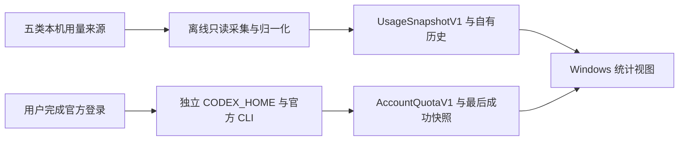

# Windows 本地统计＋Codex 额度：方案与风险

日期：2026-10-03，Asia/Shanghai。完整来源见 [sources.md](sources.md)。

## 研究结论

推荐继续使用当前 Electron、token-monitor v0.65.0 和官方 Tokscale 4.17.0 基线，保留独立离线采集与可选额度入口。AgentHub 提供有关联价值的额度与工作台设计；Win-CodexBar 提供 Windows 托盘、provider 状态与打包参考；ccusage 可提供独立核算视角。复用单位应是明确的接口规则、异常案例或小模块，每次都适配当前权限与数据合同。

没有资料证明某一个现成产品同时满足当前严格的离线采集、五来源数据口径、独立 Codex 登录和 keyring 要求。以下成熟度只评价可观察的交付形式与参考价值，不等于完整兼容或安全认证。

## 方案比较

| 方案 | 已核查的实现与交付证据 | 适合参考 | 当前适配成本与边界 | 结论 |
|---|---|---|---|---|
| token-monitor | v0.65.0 提供 Windows 安装/便携包；Electron、Tokscale、历史、额度和同步已有实现 | 现有桌面底座、字段能力目录、图表与回归案例 | 原默认入口包含账号/网络/同步和会话信息；现有 M1 已隔离。不能重新载入整套上游入口 | 保持现有基础；针对问题提取参考 |
| Tokscale | v4.17.0 固定发行版本；README 提供 Windows 原生目标和多来源解析 | 解析语义、聚合与对照校验 | main 功能不能算作已锁定版本能力；定价下载、公共提交和账号同步路径需隔离 | 保持固定官方版本与匿名投影校验 |
| AgentHub / AiGoodBro | 检查固定候选 d03430a8，2.2/1003v1；macOS 主产品，Windows Rust/Tauri/React 代码保留且后续工作暂停 | 快照年龄、错误状态、身份变化、刷新调度、官方 App Server 测试 | Token Monitor 基线为 v0.62.0；账号读写范围和技术栈与本项目不同；候选存在不代替 Windows 真机证据 | 专项参考，按规则/测试移植 |
| Win-CodexBar / CodexBar | Win-CodexBar v0.60.3 发布页及 Windows 托盘、Tauri/React/Rust 文档；CodexBar 为 macOS 原实现 | provider 状态、托盘交互、凭据保护与 Windows 包检查 | 部分来源依赖 Cookie/API key；它的 DPAPI 存储不能自动替代本项目要求的官方 CLI keyring；整仓引入增加工具链 | Windows 额度与交付参考 |
| ccusage | 当前 README 提供多 agent 本地日/周/月/会话报告、JSON 与缓存价格离线选项 | 独立账本、统计语义和异常对照 | CLI 不能直接完成桌面账号登录；若与 Tokscale 共用价格输入，仅成本结果一致不构成完全独立证据；主线与发布包版本分开 | 核算辅助，需固定实际测试版本 |
| TokenTracker | README 提供本地解析、Dashboard 与 Windows 产品；隐私文件公开默认网络和 hooks 行为 | 增量采集、字段目录、局部来源适配 | 默认匿名 heartbeat 和页面分析；可安装 hooks。严格离线和不改 agent 配置需要额外隔离；本轮只查资料 | 对照研究，暂不切换底座 |

直接依据：[token-monitor v0.65.0 发布](https://github.com/Javis603/token-monitor/releases/tag/v0.65.0)、[Tokscale v4.17.0](https://github.com/junhoyeo/tokscale/releases/tag/v4.17.0)、[AgentHub 固定候选](https://github.com/BLACKIELF/AgentHub-AiGoodBro/blob/d03430a81a4dca5b3967864d79064b2590165955/README.md)、[AgentHub Windows](https://github.com/BLACKIELF/AgentHub-AiGoodBro/blob/d03430a81a4dca5b3967864d79064b2590165955/windows/README.md)、[Win-CodexBar 发布](https://github.com/nesszer/Win-CodexBar/releases/tag/v0.60.3)、[Win-CodexBar README](https://github.com/nesszer/Win-CodexBar/blob/main/README.md)、[ccusage README](https://github.com/ccusage/ccusage/blob/main/apps/ccusage/README.md)、[TokenTracker README](https://github.com/xiufengsun/TokenTracker)、[TokenTracker 隐私](https://github.com/xiufengsun/TokenTracker/blob/main/docs/PRIVACY.md)。

## 官方接口优先于第三方认证实现

OpenAI 官方 App Server 文档提供 managed ChatGPT 登录、account/read、account/rateLimits/read、取消与 logout。额度字段包含实际窗口长度、usedPercent、resetsAt 和多个 limitId。认证文档说明 keyring 在系统存储不可用时失败，auto 会回退到文件，因此严格要求系统凭据存储时不能使用 auto。[App Server](https://learn.chatgpt.com/docs/app-server)、[认证与存储](https://learn.chatgpt.com/docs/auth)。

官方协议目录同时存在模型推理、消耗重置权益和邮件等操作，必须限制本产品可调用的方法。文档证明协议能力，不证明当前安装 CLI 支持所有最新字段，也不证明每种套餐都会返回所有窗口。

## 当前源码对照

- src/quota/rpc.js：stdio 子进程、RPC 白名单、keyring 有效配置检查、有界消息缓冲与超时；原始服务错误被安全替换为通用错误。
- src/quota/service.js：独立连接目录、登录取消、同连接刷新忙碌保护、保存失败前的最后额度；目前多数失败状态归为 error，尚未实现按错误类别的精细退避。
- src/quota/contract.js：多个额度池优先、null 语义、窗口和剩余投影、缓存字段白名单。当前接受大于 100 的 usedPercent 并将剩余钳至零；是否展示越界值或标异常，需按官方真实响应与合同决定，不能机械套用第三方的 0–100 拒绝策略。
- design/desktop-reference/quota-ui.js：缓存年龄、状态和周期刷新。展示有更新时间不代替身份核验或真实额度测试。
- docs/m1/CODEX-QUOTA.md：合成流程和空目录官方协议已有历史记录；真实登录、凭据写入/恢复、真实多个账号与网络行为仍未完成验收。

AgentHub 的 Windows reader 用相同官方账号接口，测试覆盖仅存在周窗口、套餐以更新的 quota 观察为准等案例；可借鉴其测试目标，继续保留本项目多额度池和最小缓存合同。[reader](https://github.com/BLACKIELF/AgentHub-AiGoodBro/blob/d03430a81a4dca5b3967864d79064b2590165955/windows/crates/codexu-core/src/readers/codex_app_server.rs)、[测试](https://github.com/BLACKIELF/AgentHub-AiGoodBro/blob/d03430a81a4dca5b3967864d79064b2590165955/windows/crates/codexu-core/tests/codex_app_server_quota.rs)。

## 主要风险与常见陷阱

| 优先级 | 风险 | 容易犯的错误 | 需求和后续验证 |
|---|---|---|---|
| 高 | 数据口径与费用 | 缓存/reasoning 重复加；累计快照直接求和；API 等价费用当账单；额度反推 token | 明确不重叠桶、价格版本与独立指标；每来源以人工定义账本对照，含已知零与缺失 |
| 高 | 去重和账号归因 | 归档/复制/fork 重计；同一共享 DB 算两份；历史全归当前登录账号；同账号多连接相加 | 稳定来源标识、可解释归因；无证据保持未知，连接和额度池不能求和 |
| 高 | 认证边界 | 导入既有 auth/Cookie；继承其他 API key/provider 配置；keyring 不可用仍落文件；把读额度称为专用只读 OAuth | 官方登录、独立目录、有效配置核验；真正写入与重启恢复、其他客户端状态不变需实测 |
| 高 | 快照时效与身份变化 | 失败把缓存清零；过期值当实时；重置时间到就置满；凭据变化后旧请求覆盖新状态 | lastSuccess、lastAttempt、错误类别与年龄分别保存/展示；请求世代与可用身份依据复核 |
| 高 | JSONL/SQLite 正在写入 | 半行当坏数据；只复制 db 丢失 WAL；为读取创建 SHM/执行 checkpoint；把活跃库标 immutable | 严格只读与稳定快照；当前内存 DB/WAL 路径按 source 版本验证，不开启来源写路径 |
| 高 | 网络与刷新控制 | 秒级轮询；后台重复请求；登出期间旧刷新回写；所有错误盲目重试；网络不可达就改全局代理 | 有界请求、按连接调度、可识别错误退避与退出取消；网络设置另按具体问题评审 |
| 中 | Windows 生命周期 | 源码 UI 正常就算 exe 通过；关闭窗口仍采集却未提示；休眠后计时积压；中文路径/高 DPI 裁切 | 对目录包验收真实托盘、第二实例、系统对话框、DPI、休眠和完整退出；隐私型截图用合成数据 |
| 中 | 规模与持久化 | 每 15 秒全量扫描无限历史；慢磁盘重试；崩溃损坏统计；缓存版本升级清空历史 | 声明测量规模、冷/热条件、超时和退避；原子写/恢复；超出规模再评估索引，不能静默删历史 |
| 中 | 供应链与分支混淆 | README main 当 release；候选 UI 当实连证据；同名 fork 当官方包；直接执行安装/更新脚本 | 固定 commit/tag、保留许可证、比对测试语义和打包清单；不自动更新采集核心 |

SQLite 官方文档说明 WAL 持有尚未 checkpoint 的事务；只读连接仍取决于 WAL/SHM 的存在与权限。只读并不自动意味着不会触发辅助文件操作，不能通过 immutable 选项假装活跃数据库不会变化。[SQLite WAL](https://sqlite.org/wal.html)。

错误分类应利用官方 CLI 实际提供的结构化证据。CLI 未暴露原始 HTTP 状态时，不能推测一个泛化失败就是 429，也不能为了诊断把服务原始响应或 token 写入日志。

## 边界示意

两个合同在界面并列展示，不在没有可靠账号归属时自动关联；原离线入口不加载额度网络路径。iPhone 与云端不在此图及本轮范围内。

## AgentHub 的采用建议

优先借鉴快照年龄、批量刷新成功计数、已知异常与未知状态区别，以及身份变化时丢弃旧结果的测试思路。保留当前 Nowdex 视觉目标，先修状态可解释性。

本轮排除其本地反代、账号切换、暖号/点数规则、微信控制、邀请发送和项目任务工作台。它的多提供商适配器可供未来研究；其中原生凭据读取或续期行为不能直接引入当前的最小权限设计。[CLI 额度边界](https://github.com/BLACKIELF/AgentHub-AiGoodBro/blob/d03430a81a4dca5b3967864d79064b2590165955/docs/local-cli-accounts.md)、[发布范围](https://github.com/BLACKIELF/AgentHub-AiGoodBro/blob/d03430a81a4dca5b3967864d79064b2590165955/docs/source-publication-1003v1.md)。

## 后续评审建议

下一步评审围绕三项证据：真实 Codex 官方登录与额度对照、系统凭据重启恢复和连接隔离、Windows 目录包生命周期。通过后再决定是否需要细化失败分类及调度改进。本轮不开始这些测试或编码。

长期 iPhone/外网统计的私密性约束仍有效：token-monitor 现有 Worker 在服务器 aggregateDevices，不构成端到端加密统计协议；本地加密实验也不覆盖配对/撤销/恢复。未来需要独立阶段设计，不从本次方案选型推导部署授权。[固定 Worker](https://github.com/Javis603/token-monitor/blob/v0.65.0/worker/src/index.js)、[本地实验边界](../../../docs/m1/CRYPTO-EXPERIMENT.md)。

## 不确定与证据限制

第三方运行兼容性、真实账户和所有套餐、持续运行资源消耗、供应链全审计、本机 CLI 的最新字段支持都未在本轮验证。候选数量和 stars 不用于稳定性或安全背书。CodeGraph 工具不可用，定向源码检查用于必要的现状对照；没有执行完整代码审查。研究的相同结论不等于不同测试路径已执行。
